*La matemática detrás de RAG y la recuperación de información en sistemas inteligentes.*

## Introducción

La curiosidad que despertó en mí la investigación sobre agentes de inteligencia artificial, durante el desarrollo de algunos proyectos personales, terminó llevándome a una de las arquitecturas que más me ha llamado la atención: **Retrieval-Augmented Generation (RAG)**.

En mi acercamiento al *Machine Learning* había conocido métodos de naturaleza matemática y estadística, como la regresión lineal, los Random Forest o los algoritmos de clustering. Sin embargo, RAG me produjo una fascinación diferente. No se trataba solo de entrenar un modelo para encontrar patrones o hacer predicciones, sino de entender cómo un sistema puede procesar grandes cantidades de información, organizarla, recuperar los fragmentos relevantes y usarlos como contexto para generar respuestas.

Lo que al inicio parecía una cuestión de integrar herramientas se convirtió en una pregunta mucho más interesante:

**¿Cómo transforma la inteligencia artificial documentos y datos en conocimiento recuperable, y qué fundamentos matemáticos permiten usarlo para construir sistemas inteligentes?**

Hoy existen frameworks, bibliotecas y servicios que abstraen gran parte de estos procesos. Aun así, comprender lo que sucede detrás de esas abstracciones da una perspectiva mucho más completa sobre las capacidades y los límites de estas arquitecturas.

Por eso, en este recorrido no me limito a describir cómo implementar un sistema RAG. Quiero explorar **por qué funciona**, qué problemas intenta resolver y qué principios intervienen en cada etapa. El camino es el siguiente:

1. Cómo se representa el lenguaje mediante vectores (Word2Vec).
2. Cómo se recuperan pasajes relevantes para una consulta (DPR).
3. Cómo se buscan vectores de manera eficiente (vecinos más cercanos y HNSW).
4. Cómo el modelo generativo combina la recuperación con la generación (RAG-Sequence y RAG-Token).
5. Un ejemplo completo de principio a fin.

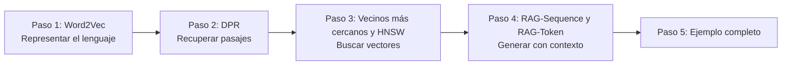

## ¿Cómo aprende una máquina a representar el lenguaje?

Para construir representaciones vectoriales del lenguaje necesitamos un modelo capaz de aprender regularidades a partir de grandes cantidades de texto. Uno de los enfoques más conocidos para entender este proceso es **Word2Vec**, presentado por Mikolov y colaboradores en 2013.

Su idea fundamental parte de la hipótesis distribucional: las palabras que aparecen en contextos similares tienden a compartir propiedades lingüísticas y semánticas. En lugar de asignar una representación arbitraria a cada palabra, Word2Vec aprende sus vectores mediante una tarea de predicción basada en las relaciones que existen entre ellas dentro de una oración.

Para ello considera una **ventana de contexto** alrededor de cada palabra. Por ejemplo, dada la oración:

> La inteligencia artificial transforma la información.

Si elegimos *transforma* como palabra central y una ventana de dos palabras a cada lado, su contexto estará formado por *inteligencia*, *artificial*, *la* e *información*.

A partir de esta relación, Word2Vec propone dos arquitecturas de aprendizaje:

- **CBOW (Continuous Bag of Words):** usa las palabras del contexto para predecir la palabra central.
- **Skip-Gram:** usa la palabra central para predecir las palabras de su contexto.

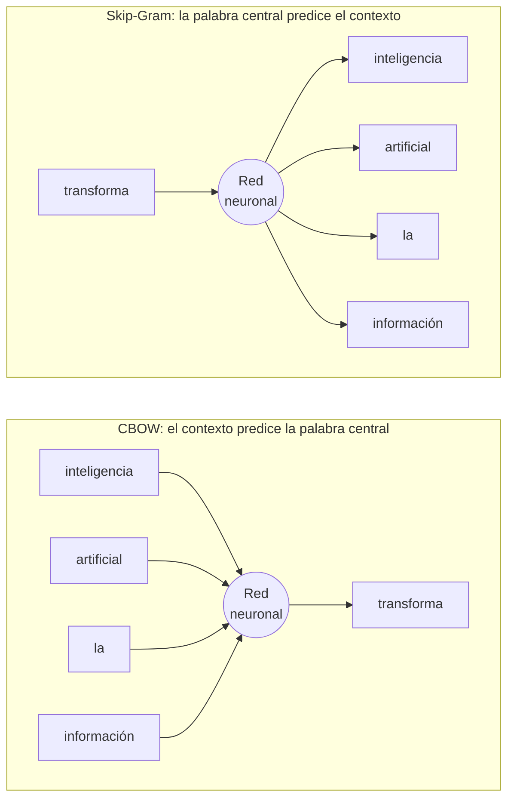

Ambas tareas se pueden expresar mediante probabilidades condicionales. En CBOW, el objetivo es estimar:

$$
P(w_t \mid w_{t-c},\ldots,w_{t+c})
$$

Esta expresión es la probabilidad de encontrar la palabra $w_t$ dado el conjunto de palabras que forman su contexto. El símbolo $P$ representa una probabilidad y la barra vertical indica que se calcula bajo una condición: conocer las palabras que rodean a la que queremos predecir.

En nuestro ejemplo, la expresión se convierte en:

$$
P(\text{transforma} \mid \text{inteligencia, artificial, la, información})
$$

El modelo recibe las cuatro palabras del contexto y calcula una distribución de probabilidades sobre su vocabulario. Supongamos que obtiene los siguientes resultados:

| Palabra candidata | Probabilidad |
|---|---|
| transforma | 0.72 |
| procesa | 0.15 |
| analiza | 0.08 |
| desarrolla | 0.05 |

Aquí *transforma* obtiene la probabilidad más alta y, por tanto, sería la predicción del modelo. Los valores son ilustrativos, pero muestran cómo CBOW convierte el contexto en una tarea de predicción.

Skip-Gram invierte el procedimiento y estima:

$$
P(w_{t+j} \mid w_t)
$$

Aquí $w_t$ es la palabra central y $w_{t+j}$ una palabra situada en alguna posición de su contexto. Si tomamos de nuevo *transforma*, el modelo intenta predecir palabras como *inteligencia*, *artificial*, *la* e *información* a partir de ella.

Aunque ambas arquitecturas invierten la dirección de la predicción, comparten el mismo propósito: ajustar los parámetros de una red neuronal para aprender representaciones útiles de las palabras. De esos parámetros se obtienen los vectores que representan cada palabra:

$$
\mathbf{v}_w \in \mathbb{R}^{d}
$$

Esto indica que la palabra $w$ queda representada por un vector de $d$ componentes reales. Por ejemplo, con $d=3$, una palabra podría representarse así:

$$
\mathbf{v}_{\text{transforma}} =
\begin{bmatrix}
0.25 \\
-0.41 \\
0.78
\end{bmatrix}
$$

En los modelos reales la dimensión suele ser mucho mayor. Lo importante es que estos valores no se asignan manualmente: se aprenden durante el entrenamiento. Así, las regularidades estadísticas encontradas en los contextos se reflejan en las posiciones de las palabras dentro del espacio vectorial, y las palabras que comparten patrones de uso pueden adquirir representaciones relacionadas.

Esta es una de las ideas que más me interesa del proceso: el lenguaje, que inicialmente se presenta como una secuencia de símbolos, puede representarse mediante objetos matemáticos sobre los que es posible operar y establecer relaciones.

### ¿De dónde salen los valores de cada vector?

Para entender de dónde surgen estos números, veamos cómo Word2Vec representa internamente las palabras. Primero construye un vocabulario con las palabras del corpus y asigna a cada una un identificador. Luego usa una representación llamada *One-Hot Encoding*: un vector de ceros con un único uno, cuya posición identifica una palabra específica.

Por ejemplo, si nuestro vocabulario contiene cinco palabras:

$$
V = [\text{la, inteligencia, artificial, transforma, información}]
$$

la palabra *transforma* se representa como:

$$
\mathbf{x}_{\text{transforma}} =
\begin{bmatrix}
0 & 0 & 0 & 1 & 0
\end{bmatrix}
$$

Esta representación identifica la palabra, pero no expresa relaciones semánticas con las demás. Para aprenderlas, Word2Vec incorpora una matriz de pesos $W$, cuyos valores se inicializan generalmente de forma aleatoria:

$$
W \in \mathbb{R}^{\lvert V \rvert \times d}
$$

Aquí $\lvert V \rvert$ es el tamaño del vocabulario y $d$ la dimensión de cada representación. Cada fila de la matriz corresponde a una palabra del vocabulario y contiene sus valores asociados.

Cuando multiplicamos el vector One-Hot por la matriz de pesos:

$$
\mathbf{h} = \mathbf{x}_{\text{transforma}}\, W
$$

obtenemos la fila de $W$ correspondiente a *transforma*. Esa fila es su representación vectorial inicial. Con tres componentes, sus valores podrían comenzar siendo completamente arbitrarios, por ejemplo:

$$
\mathbf{v}_{\text{transforma}} =
\begin{bmatrix}
0.25 & -0.41 & 0.78
\end{bmatrix}
$$

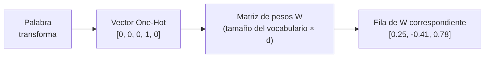

Estos números todavía no contienen necesariamente información útil. Es durante el entrenamiento cuando adquieren significado estadístico.

Cada vez que el modelo intenta predecir una palabra o su contexto, compara su predicción con la palabra observada y calcula un error mediante una **función de pérdida**. A partir de ese error, un algoritmo de optimización, como el descenso del gradiente, actualiza los pesos de la red. El proceso se repite sobre los ejemplos del corpus hasta que las representaciones permiten hacer mejores predicciones.

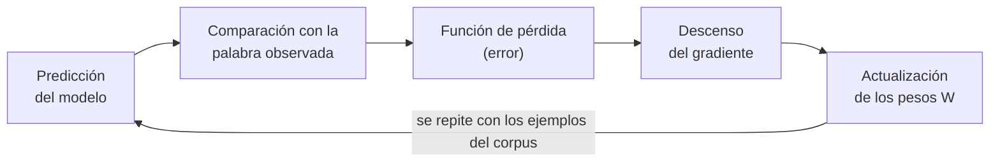

Así, los valores de cada vector dejan de ser números iniciales y pasan a ser parámetros aprendidos a partir de las relaciones entre palabras. **La representación vectorial no se construye asignando un significado a cada dimensión, sino que emerge del proceso de entrenamiento.**

### ¿Cómo se reflejan las relaciones entre palabras en el espacio vectorial?

Una vez entrenado Word2Vec, cada palabra tiene una representación en $\mathbb{R}^d$. Esto permite comparar sus vectores con operaciones del álgebra lineal. Una de las medidas más usadas es la **similitud coseno**:

$$
\operatorname{sim}(\mathbf{u},\mathbf{v}) =
\frac{\mathbf{u}\cdot\mathbf{v}}
{\lVert\mathbf{u}\rVert\,\lVert\mathbf{v}\rVert}
$$

¿Qué significa realmente esta expresión?

- $\mathbf{u}$ y $\mathbf{v}$ son los vectores que queremos comparar.
- $\mathbf{u}\cdot\mathbf{v}$ es su producto interno.
- $\lVert\mathbf{u}\rVert$ y $\lVert\mathbf{v}\rVert$ son sus normas, es decir, sus longitudes.

El producto interno mide la relación entre las componentes de ambos vectores, mientras que las normas normalizan el resultado para considerar principalmente la orientación de cada vector en el espacio.

Geométricamente, la expresión equivale al coseno del ángulo $\theta$ entre los dos vectores:

$$
\operatorname{sim}(\mathbf{u},\mathbf{v}) = \cos(\theta)
$$

Si dos vectores tienen una orientación similar, el ángulo es pequeño y la similitud se acerca a $1$. Si son perpendiculares, el resultado es $0$, y si apuntan en direcciones opuestas, es $-1$. Esto permite estudiar qué palabras tienen relaciones estadísticas similares dentro del espacio aprendido.

> [!NOTE]
> Una similitud elevada no significa necesariamente que dos palabras sean sinónimos. Pueden aparecer en contextos parecidos por otras razones, como relaciones de asociación o complementariedad.

### ¿Por qué nos interesa esto para RAG?

Con Word2Vec vimos cómo una red neuronal aprende representaciones vectoriales a partir de las relaciones entre palabras y cómo podemos compararlas con operaciones matemáticas.

Sin embargo, en un sistema de recuperación no queremos comparar únicamente palabras aisladas. Necesitamos representar consultas y documentos completos, calcular su afinidad y recuperar los más relevantes. Ese es el problema que aborda **Dense Passage Retrieval (DPR)**.

## De la representación del lenguaje a la recuperación de información

### Dense Passage Retrieval (DPR)

Para recuperar información necesitamos representar unidades de texto más amplias, como consultas y pasajes de documentos. **DPR**, presentado por Karpukhin y colaboradores en 2020, recupera los pasajes más relevantes para una consulta mediante representaciones vectoriales aprendidas con redes neuronales.

DPR usa una arquitectura llamada *Dual-Encoder*, formada por dos codificadores independientes: uno para las consultas y otro para los pasajes.

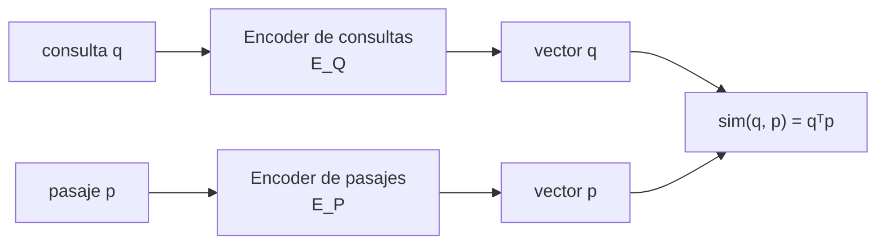

Sus operaciones se representan con dos funciones:

$$
\mathbf{q} = E_Q(q)
$$

$$
\mathbf{p} = E_P(p)
$$

Aquí $q$ es una consulta y $p$ un pasaje. Las funciones $E_Q$ y $E_P$ son los codificadores (*encoders*), y $\mathbf{q}$ y $\mathbf{p}$ son los vectores que producen. Ambos tienen la misma dimensión, lo que permite compararlos en un espacio vectorial común.

En la implementación original se usan dos redes BERT independientes. De sus representaciones se toma el vector del token especial `[CLS]`, que funciona como representación del texto completo. En el modelo BERT-base usado por los autores, estos vectores tienen 768 dimensiones.

### ¿Cómo compara una consulta con los pasajes?

Una vez obtenidas las representaciones, DPR usa el producto interno como función de puntuación:

$$
\operatorname{sim}(q,p) = \mathbf{q}^{\top}\mathbf{p}
$$

El símbolo $\top$ indica la transposición del vector, que permite realizar la multiplicación. Para verlo con números, imaginemos que el codificador produce este vector para una consulta:

$$
\mathbf{q} =
\begin{bmatrix}
1 & 2 & 0
\end{bmatrix}
$$

y que dos pasajes producen estas representaciones:

$$
\mathbf{p}_1 =
\begin{bmatrix}
2 & 1 & 0
\end{bmatrix}
\qquad
\mathbf{p}_2 =
\begin{bmatrix}
0 & 1 & 2
\end{bmatrix}
$$

El producto interno se obtiene multiplicando las componentes que ocupan la misma posición y sumando los resultados. Para el primer pasaje:

$$
\begin{aligned}
\operatorname{sim}(q,p_1) &= (1)(2) + (2)(1) + (0)(0) \\
&= 4
\end{aligned}
$$

y para el segundo:

$$
\begin{aligned}
\operatorname{sim}(q,p_2) &= (1)(0) + (2)(1) + (0)(2) \\
&= 2
\end{aligned}
$$

El primer pasaje obtiene una puntuación mayor, así que DPR ordenaría primero a $p_1$. Los vectores son ilustrativos y tienen tres componentes para facilitar el cálculo; en el modelo original tienen muchas más dimensiones y sus valores los generan los codificadores neuronales.

### ¿Cómo selecciona los documentos recuperados?

Este procedimiento se repite para todos los pasajes de la colección. Cada uno recibe una puntuación con respecto a la consulta y luego se ordenan según esos resultados. La selección se expresa así:

$$
\mathcal{P}_k =
\operatorname{TopK}_{p\in\mathcal{D}}
\left(\mathbf{q}^{\top}\mathbf{p}\right)
$$

$\mathcal{D}$ es el conjunto de pasajes disponibles y $k$ cuántos queremos recuperar. La operación $\operatorname{TopK}$ selecciona los $k$ pasajes con las puntuaciones más altas.

En la práctica, DPR calcula de antemano las representaciones de los pasajes y las guarda en un índice vectorial. Cuando llega una consulta, solo necesita generar su vector y buscar los de mayor puntuación. El trabajo original usa FAISS para hacer esta búsqueda de forma eficiente.

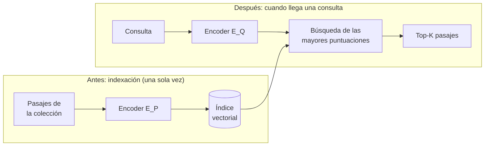

De esta forma, la recuperación deja de depender exclusivamente de encontrar palabras coincidentes entre la consulta y el documento: el modelo puede identificar relaciones aprendidas entre sus representaciones y usarlas para ordenar por relevancia.

### Entrenamiento del recuperador: aprendizaje contrastivo

El producto interno por sí solo no garantiza que los documentos relevantes obtengan las puntuaciones más altas. Para lograrlo, hay que entrenar los codificadores con ejemplos que indiquen qué pasajes responden a cada consulta.

DPR usa ejemplos formados por una consulta $q$, un pasaje positivo $p^+$ (relevante) y uno o varios pasajes negativos $p^-$ (no relevantes para esa consulta). Por ejemplo, para la consulta:

> ¿Cómo funciona la fotosíntesis?

podríamos disponer de estos pasajes:

- **Pasaje positivo:** explica cómo las plantas usan la luz solar para transformar agua y dióxido de carbono en glucosa.
- **Pasaje negativo:** describe el funcionamiento del sistema circulatorio humano.
- **Pasaje negativo:** explica las etapas de la Revolución Industrial.

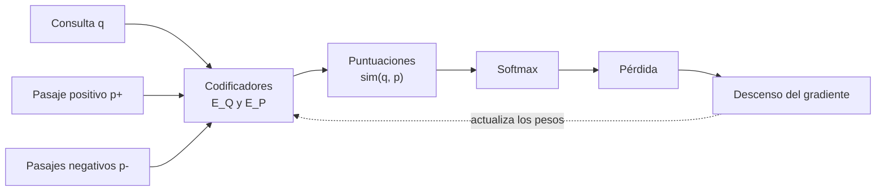

El objetivo es que el codificador aprenda a asignar una puntuación mayor al pasaje positivo que a los negativos. Para expresarlo, DPR usa una función de pérdida basada en *Softmax* y en la probabilidad del pasaje positivo:

$$
\mathcal{L} = -\log
\frac{
e^{\operatorname{sim}(q,p^+)}
}{
e^{\operatorname{sim}(q,p^+)}
+
\sum_{j=1}^{n} e^{\operatorname{sim}(q,p_j^-)}
}
$$

Aunque parece compleja, podemos entenderla por partes:

- $q$: la consulta.
- $p^+$: el pasaje positivo, el que consideramos relevante.
- $p_j^-$: cada uno de los $n$ pasajes negativos.
- $\operatorname{sim}(q,p)$: la puntuación obtenida mediante el producto interno.
- $e^x$: la función exponencial, que transforma las puntuaciones en valores positivos.
- $-\log$: penaliza al modelo cuando asigna poca probabilidad al pasaje positivo.

**¿Qué calcula realmente esta fórmula?** El cociente es la probabilidad que el modelo asigna al pasaje positivo frente al conjunto de pasajes considerados. El denominador reúne las puntuaciones transformadas del positivo y de todos los negativos.

Veamos un ejemplo numérico con estas puntuaciones:

| Pasaje | Puntuación |
|---|---|
| Positivo | 3 |
| Negativo 1 | 1 |
| Negativo 2 | -1 |

Al aplicar la función exponencial obtenemos:

$$
\begin{aligned}
e^{3} &\approx 20.09 \\
e^{1} &\approx 2.72 \\
e^{-1} &\approx 0.37
\end{aligned}
$$

La probabilidad asignada al pasaje positivo es:

$$
\frac{20.09}{20.09 + 2.72 + 0.37} \approx 0.867
$$

Es decir, el modelo asigna aproximadamente un 86.7 % de probabilidad al pasaje relevante dentro de este conjunto. La pérdida se obtiene con el logaritmo negativo:

$$
\mathcal{L} = -\log(0.867) \approx 0.143
$$

Cuanto mayor es la probabilidad asignada al pasaje positivo, menor es la pérdida. Si el modelo asigna puntuaciones parecidas a los pasajes positivos y negativos, la pérdida será mayor.

Durante el entrenamiento, el algoritmo de optimización usa esta pérdida para calcular cómo modificar los parámetros de los codificadores. Mediante el descenso del gradiente, los pesos se actualizan para aumentar la puntuación de los positivos frente a los negativos. El proceso se repite con numerosos ejemplos hasta que los codificadores aprenden representaciones que distinguen mejor los pasajes relevantes.

Un detalle importante: los pasajes negativos no son necesariamente incorrectos en términos absolutos; simplemente no son los seleccionados como relevantes para esa consulta. Además, DPR puede usar **negativos difíciles** (*hard negatives*), es decir, pasajes que parecen relacionados con la consulta pero no son la respuesta adecuada.

## ¿Cómo se recuperan los vectores de manera eficiente?

### Búsqueda de vecinos más cercanos

Una vez que los documentos se transformaron en vectores, sus representaciones pueden guardarse en un índice vectorial. Cuando llega una consulta, el sistema genera su vector y debe encontrar los pasajes cuyas representaciones tengan mayor similitud con él.

Matemáticamente, si tenemos una colección de vectores:

$$
\mathcal{V} = \{\mathbf{p}_1, \mathbf{p}_2, \ldots, \mathbf{p}_m\}
$$

y una consulta representada por $\mathbf{q}$, necesitamos encontrar los $k$ vectores con las puntuaciones más altas:

$$
\operatorname{TopK}_{\mathbf{p}_i\in\mathcal{V}}
\left(\mathbf{q}^{\top}\mathbf{p}_i\right)
$$

El problema es que, con millones de documentos, calcular el producto interno entre la consulta y cada vector es costoso. Por eso existen algoritmos que realizan búsquedas **aproximadas** sin comparar exhaustivamente todos los elementos. Uno de ellos es **HNSW (Hierarchical Navigable Small World)**, que organiza los vectores en una estructura de grafos jerárquicos.

### ¿Cómo funciona HNSW?

La idea es representar los vectores como nodos de un grafo y conectar los que están próximos en el espacio vectorial. En lugar de comparar la consulta contra todos los vectores, nos desplazamos entre nodos siguiendo conexiones que nos acercan progresivamente a los candidatos más relevantes.

HNSW organiza estos grafos en niveles:

- **Nivel inferior:** contiene todos los nodos y más conexiones, lo que permite una búsqueda detallada.
- **Niveles superiores:** contienen subconjuntos más pequeños de nodos y permiten recorrer rápidamente regiones amplias del espacio.

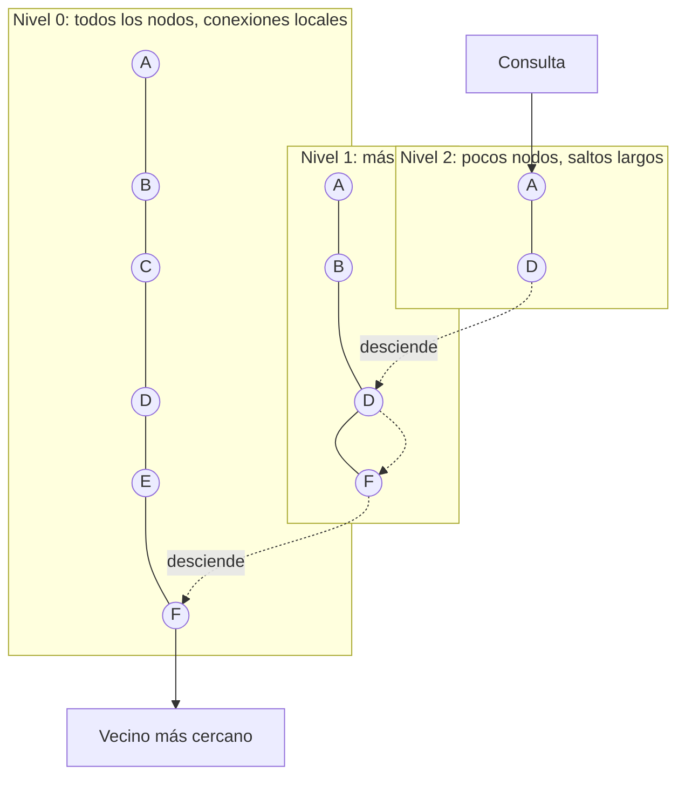

El procedimiento de búsqueda puede entenderse en cinco pasos:

1. **Inicio:** el algoritmo comienza en un nodo de entrada de los niveles superiores.
2. **Exploración:** compara el vector de la consulta con los nodos vecinos y se desplaza hacia el que ofrece mejor proximidad.
3. **Descenso:** cuando ya no encuentra un vecino mejor en el nivel actual, baja al siguiente nivel y continúa.
4. **Refinamiento:** al llegar al nivel inferior, explora un conjunto más amplio de candidatos para encontrar los vectores más cercanos.
5. **Resultado:** devuelve los $k$ vecinos que considera más próximos a la consulta.

Para decidir hacia dónde moverse, la búsqueda usa una medida de distancia o similitud. En un sistema con producto interno, como el recuperador DPR, los candidatos se ordenan según su puntuación de similitud.

### ¿Por qué se considera una búsqueda aproximada?

En una búsqueda **exacta** se comparan todos los vectores de la colección y se seleccionan los $k$ mejores. En cambio, HNSW explora solo una parte de la estructura, usando sus conexiones para encontrar candidatos prometedores. Esto reduce el trabajo de búsqueda, pero existe la posibilidad de que no devuelva exactamente los mismos vecinos que una búsqueda exhaustiva.

HNSW permite controlar este comportamiento mediante parámetros como:

- $M$: cantidad de conexiones que puede mantener cada nodo.
- $ef_{\text{construction}}$: tamaño del conjunto de candidatos considerado al construir el índice.
- $ef_{\text{search}}$: tamaño del conjunto de candidatos explorados durante la búsqueda.

En general, aumentar $ef_{\text{search}}$ permite explorar más candidatos y puede mejorar la precisión, aunque también incrementa el costo computacional. HNSW establece así un equilibrio entre velocidad y calidad: no recorre toda la colección, sino que aprovecha la organización geométrica de los vectores mediante una jerarquía de conexiones.

### De los vectores a los fragmentos de texto

Tras la búsqueda, el índice devuelve los identificadores de los vectores más cercanos a la consulta. Estos identificadores no contienen por sí mismos el texto que necesitamos darle al modelo generativo. Por eso, durante la indexación, cada embedding conserva una referencia al fragmento del que fue generado.

El proceso completo puede resumirse así:

1. **Búsqueda:** el sistema codifica la consulta y usa el índice para encontrar los fragmentos con mayor similitud.
2. **Selección:** se eligen los resultados más relevantes. En algunos sistemas se recuperan más candidatos de los necesarios y luego se reordenan con una comparación más precisa o un modelo de *reranking*.
3. **Recuperación del contenido:** a partir de los identificadores seleccionados, el sistema consulta el almacenamiento y obtiene los fragmentos originales.

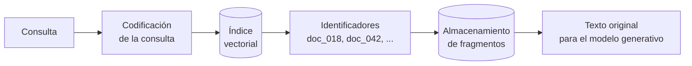

Por ejemplo, si el usuario pregunta «¿Cómo funciona la fotosíntesis?», el recuperador podría encontrar estos fragmentos:

| Identificador | Contenido recuperado |
|---|---|
| `doc_018` | Las plantas utilizan la energía de la luz solar para transformar agua y dióxido de carbono en glucosa y oxígeno. |
| `doc_042` | La clorofila es un pigmento que absorbe parte de la energía luminosa necesaria para la fotosíntesis. |
| `doc_105` | La respiración celular permite a las células obtener energía a partir de moléculas orgánicas. |

El sistema reúne estos fragmentos y los usa como contexto adicional para que el modelo generativo elabore la respuesta.

## De la recuperación a la generación: RAG

Hasta aquí vimos cómo representar texto y recuperar los fragmentos más relevantes. La arquitectura **RAG**, propuesta por Lewis y colaboradores en 2020, conecta esa recuperación con un modelo generativo. En su formulación probabilística, el recuperador asigna una probabilidad $p_\eta(z \mid x)$ a cada documento $z$ dada la consulta $x$, y el generador asigna una probabilidad $p_\theta(y \mid x, z)$ a la respuesta $y$ dados la consulta y el documento.

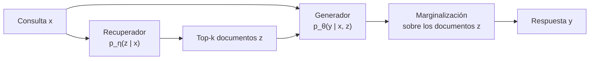

Como no sabemos qué documento es el «correcto», el modelo **marginaliza** sobre los documentos recuperados, es decir, combina las contribuciones de todos ellos ponderadas por su probabilidad de recuperación. El artículo propone dos formas de hacerlo.

### RAG-Sequence

En RAG-Sequence, la probabilidad de generar la secuencia completa se calcula marginalizando sobre los documentos recuperados:

$$
p_{\text{RAG-Sequence}}(y \mid x) \approx
\sum_{z\in \operatorname{top-k}(p_\eta(\cdot \mid x))}
p_\eta(z \mid x)\, p_\theta(y \mid x,z)
$$

Sus componentes son:

- $x$: la consulta o entrada original del usuario.
- $y$: la secuencia de tokens que constituye la respuesta generada.
- $z$: uno de los documentos recuperados.
- $p_\eta(z \mid x)$: probabilidad que asigna el recuperador a que $z$ sea relevante para $x$.
- $p_\theta(y \mid x,z)$: probabilidad de que el generador produzca la respuesta $y$, considerando la consulta y el documento.
- $\operatorname{top-k}$: el conjunto de los $k$ documentos con mayor relevancia estimada.

La sumatoria indica que el sistema considera cada documento recuperado y combina las probabilidades de generar la respuesta completa a partir de él, ponderadas por la probabilidad de recuperación. Para verlo, supongamos que el recuperador encuentra dos documentos:

| Documento | Probabilidad de recuperación |
|---|---|
| $z_1$ | 0.7 |
| $z_2$ | 0.3 |

y que el generador asigna a una respuesta determinada estas probabilidades:

| Documento utilizado | Probabilidad de generar la respuesta |
|---|---|
| $z_1$ | 0.8 |
| $z_2$ | 0.4 |

Al sustituir en la expresión:

$$
p(y \mid x) = (0.7 \times 0.8) + (0.3 \times 0.4) = 0.56 + 0.12 = 0.68
$$

El resultado es la probabilidad marginal de esa respuesta bajo los documentos considerados. El primer documento contribuye más porque el recuperador le asignó una probabilidad mayor y el generador encontró más probable la respuesta usándolo.

Para entender cómo se calcula $p_\theta(y \mid x,z)$, observemos que la respuesta se genera token por token:

$$
p_\theta(y \mid x,z) = \prod_{i=1}^{N} p_\theta(y_i \mid x,z,y_{1:i-1})
$$

Aquí $N$ es la cantidad de tokens de la respuesta, $y_i$ el token generado en la posición $i$ y $y_{1:i-1}$ todos los tokens anteriores. El producto indica que la probabilidad de la secuencia completa se obtiene multiplicando las probabilidades condicionales de cada token.

Por tanto, en RAG-Sequence cada documento se considera como contexto para generar la respuesta completa, y las posibles generaciones se combinan mediante la distribución del recuperador.

### RAG-Token

En RAG-Token, la marginalización sobre los documentos se hace token por token:

$$
p_{\text{RAG-Token}}(y \mid x) \approx
\prod_{i=1}^{N}
\sum_{z\in \operatorname{top-k}(p_\eta(\cdot \mid x))}
p_\eta(z \mid x)\,
p_\theta(y_i \mid x,z,y_{1:i-1})
$$

La diferencia con RAG-Sequence está en el orden de las operaciones:

- **RAG-Sequence:** calcula la probabilidad de la respuesta completa con cada documento y después combina los resultados.
- **RAG-Token:** combina las probabilidades de cada token considerando todos los documentos y después multiplica para obtener la probabilidad de la secuencia.

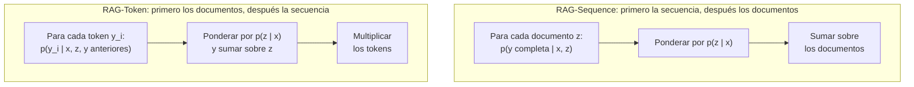

Retomemos la pregunta sobre la fotosíntesis. Supongamos que el recuperador encuentra dos documentos:

- **Documento 1:** explica que la fotosíntesis usa la energía de la luz solar para producir glucosa.
- **Documento 2:** explica que la clorofila absorbe la energía luminosa y participa en el proceso.

con las probabilidades:

$$
p_\eta(z_1 \mid x) = 0.7
\qquad
p_\eta(z_2 \mid x) = 0.3
$$

Ahora imaginemos que el modelo debe generar la respuesta «La clorofila absorbe». Analizaremos tres tokens con probabilidades ilustrativas:

| Token | Prob. con documento 1 | Prob. con documento 2 |
|---|---|---|
| La | 0.8 | 0.6 |
| clorofila | 0.4 | 0.9 |
| absorbe | 0.7 | 0.5 |

Para cada token multiplicamos la probabilidad que el recuperador asignó a cada documento por la que el generador asignó al token bajo ese documento, y sumamos las contribuciones.

**Primer token: «La»**

$$
p(y_1 \mid x) = (0.7 \times 0.8) + (0.3 \times 0.6) = 0.56 + 0.18 = 0.74
$$

**Segundo token: «clorofila»**

$$
p(y_2 \mid x) = (0.7 \times 0.4) + (0.3 \times 0.9) = 0.28 + 0.27 = 0.55
$$

**Tercer token: «absorbe»**

$$
p(y_3 \mid x) = (0.7 \times 0.7) + (0.3 \times 0.5) = 0.49 + 0.15 = 0.64
$$

Multiplicamos las probabilidades marginales para obtener la de la secuencia:

$$
p(y \mid x) \approx 0.74 \times 0.55 \times 0.64 \approx 0.2605
$$

Lo interesante es que la contribución de cada documento puede variar según el token. El documento 1 influye más en la probabilidad de «La», mientras que el documento 2 contribuye más a «clorofila». Esto no significa que el modelo cambie de documento en cada palabra: en cada posición combina las probabilidades que el generador asigna a ese token bajo los distintos documentos recuperados.

De esta manera, RAG-Token permite que varios documentos contribuyan a distintas partes de una misma respuesta, sin exigir que un único documento explique la secuencia completa.

## Ejemplo práctico: de un archivo a una respuesta mediante RAG

Imaginemos que tenemos un archivo llamado `fotosintesis.txt` y queremos que un LLM responda preguntas usando su contenido. El archivo contiene lo siguiente:

> La fotosíntesis es el proceso mediante el cual las plantas transforman la energía luminosa en energía química.
>
> Durante este proceso, las plantas absorben agua a través de sus raíces y dióxido de carbono del aire.
>
> La clorofila es el pigmento que absorbe la energía de la luz necesaria para llevar a cabo la fotosíntesis.
>
> Como resultado, las plantas producen glucosa y liberan oxígeno al ambiente.

El flujo completo que vamos a recorrer es este:

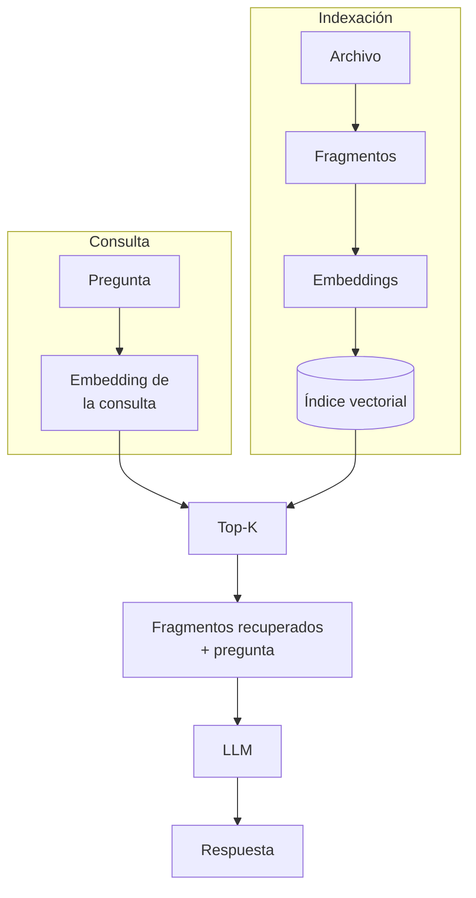

### 1. Indexación del documento

Primero, el sistema divide el archivo en fragmentos (*chunks*) para facilitar su recuperación. En este ejemplo obtenemos cuatro:

| ID | Contenido |
|---|---|
| C1 | Las plantas transforman la energía luminosa en energía química mediante la fotosíntesis. |
| C2 | Las plantas absorben agua a través de sus raíces y dióxido de carbono del aire. |
| C3 | La clorofila es el pigmento que absorbe la energía de la luz necesaria para la fotosíntesis. |
| C4 | Las plantas producen glucosa y liberan oxígeno al ambiente. |

Luego, un modelo de embeddings transforma cada fragmento en un vector. Para simplificar los cálculos usaremos vectores de tres dimensiones:

$$
C_1 = [0.9,\ 0.1,\ 0.2]
\qquad
C_2 = [0.2,\ 0.9,\ 0.1]
$$

$$
C_3 = [0.8,\ 0.2,\ 0.7]
\qquad
C_4 = [0.3,\ 0.4,\ 0.9]
$$

Estos vectores se almacenan en un índice vectorial junto con sus identificadores y referencias a los fragmentos originales. En este punto, el documento ya está preparado para ser consultado.

### 2. Recuperación de información

Ahora un usuario realiza la siguiente pregunta:

**¿Qué pigmento absorbe la luz y qué produce la planta durante la fotosíntesis?**

El sistema la transforma en un vector mediante el codificador de consultas:

$$
q = [0.8,\ 0.1,\ 0.8]
$$

y lo compara con los embeddings almacenados usando el producto interno:

$$
\operatorname{sim}(q, C_i) = q^{\top} C_i
$$

Los cálculos son:

**Comparación con C1:**

$$
(0.8 \times 0.9) + (0.1 \times 0.1) + (0.8 \times 0.2) = 0.89
$$

**Comparación con C2:**

$$
(0.8 \times 0.2) + (0.1 \times 0.9) + (0.8 \times 0.1) = 0.33
$$

**Comparación con C3:**

$$
(0.8 \times 0.8) + (0.1 \times 0.2) + (0.8 \times 0.7) = 1.22
$$

**Comparación con C4:**

$$
(0.8 \times 0.3) + (0.1 \times 0.4) + (0.8 \times 0.9) = 1.00
$$

El orden de relevancia resultante es:

| Fragmento | Puntuación |
|---|---|
| C3 | 1.22 |
| C4 | 1.00 |
| C1 | 0.89 |
| C2 | 0.33 |

Si establecemos $K=2$, el sistema selecciona los dos fragmentos con mayor puntuación:

$$
\operatorname{TopK} = \{C_3,\ C_4\}
$$

y recupera el contenido original asociado a esos identificadores:

- **C3:** La clorofila es el pigmento que absorbe la energía de la luz necesaria para llevar a cabo la fotosíntesis.
- **C4:** Las plantas producen glucosa y liberan oxígeno al ambiente.

Observemos que el sistema no necesita enviar todo el archivo al modelo generativo: solo recupera los fragmentos que considera más relevantes para la consulta.

### 3. Generación de la respuesta

Con los fragmentos recuperados, el sistema construye una entrada que combina la pregunta original con la información encontrada. Por ejemplo:

**Instrucción:** Responde utilizando la información del contexto proporcionado.

**Contexto:**

- La clorofila es el pigmento que absorbe la energía de la luz necesaria para llevar a cabo la fotosíntesis.
- Las plantas producen glucosa y liberan oxígeno al ambiente.

**Pregunta:** ¿Qué pigmento absorbe la luz y qué produce la planta durante la fotosíntesis?

Esta entrada se entrega al LLM, que usa el contexto recuperado para generar su respuesta. La generación de cada token sigue la expresión:

$$
p_\theta(y_i \mid x, z, y_{1:i-1})
$$

Supongamos que, para el primer token, el modelo obtiene esta distribución hipotética:

| Token | Probabilidad |
|---|---|
| La | 0.70 |
| El | 0.20 |
| Durante | 0.10 |

El modelo selecciona «La». Después vuelve a calcular las probabilidades considerando también el token generado:

| Siguiente token | Probabilidad |
|---|---|
| clorofila | 0.85 |
| fotosíntesis | 0.10 |
| planta | 0.05 |

Selecciona «clorofila» y continúa el proceso hasta construir una respuesta completa. Finalmente, el LLM podría responder:

> La clorofila es el pigmento que absorbe la energía luminosa necesaria para la fotosíntesis. Durante este proceso, las plantas producen glucosa y liberan oxígeno al ambiente.

### 4. Resultado del proceso

Así funciona la orquestación RAG de principio a fin:

1. El archivo se divide en fragmentos.
2. Cada fragmento se transforma en un embedding y se almacena junto con su referencia al texto original.
3. El usuario hace una pregunta, que también se transforma en un vector.
4. El sistema compara la consulta con los vectores almacenados y selecciona los fragmentos más relevantes.
5. Recupera el texto original asociado a esos fragmentos.
6. Combina la pregunta con el contenido recuperado y lo entrega al LLM.
7. El LLM genera una respuesta usando esa información como contexto.

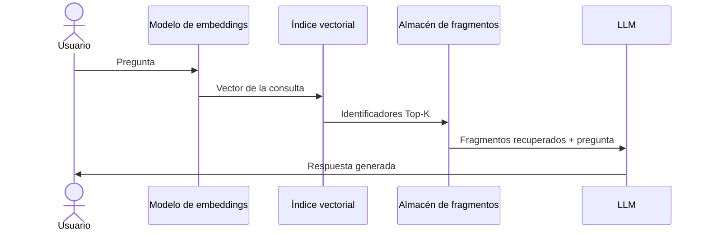

RAG conecta así la recuperación de información externa con la capacidad generativa de un modelo de lenguaje. El resultado es un sistema que puede consultar documentos disponibles fuera de sus parámetros y usarlos para construir respuestas contextualizadas.

## Conclusión

Lo que comenzó como un conjunto de documentos termina convirtiéndose en información que una máquina puede representar, localizar y utilizar para construir respuestas. Detrás de esa aparente capacidad de comprensión existe una arquitectura de representaciones matemáticas, algoritmos de búsqueda y modelos probabilísticos que conectan el lenguaje con el conocimiento.

## Referencias

- Mikolov, T., Chen, K., Corrado, G. y Dean, J. (2013). *Efficient Estimation of Word Representations in Vector Space*. arXiv:1301.3781.
- Karpukhin, V. et al. (2020). *Dense Passage Retrieval for Open-Domain Question Answering*. EMNLP 2020. arXiv:2004.04906.
- Lewis, P. et al. (2020). *Retrieval-Augmented Generation for Knowledge-Intensive NLP Tasks*. NeurIPS 2020. arXiv:2005.11401.
- Malkov, Y. A. y Yashunin, D. A. (2018). *Efficient and robust approximate nearest neighbor search using Hierarchical Navigable Small World graphs*. IEEE TPAMI. arXiv:1603.09320.